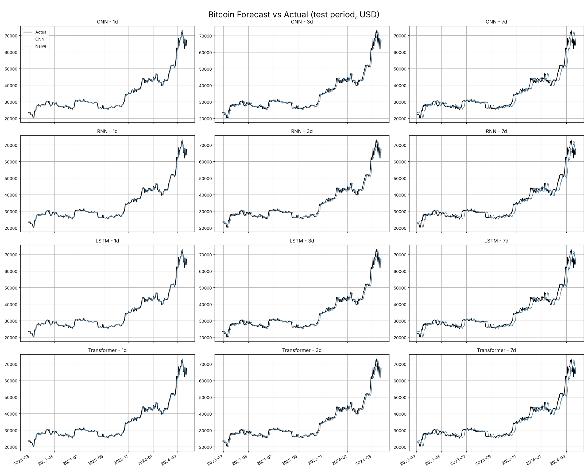
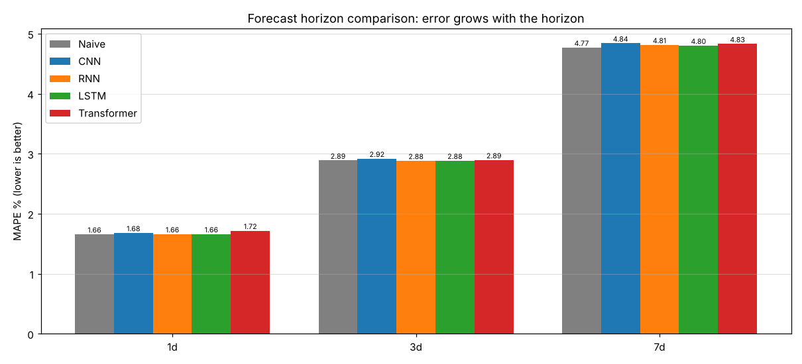
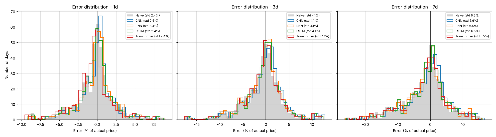
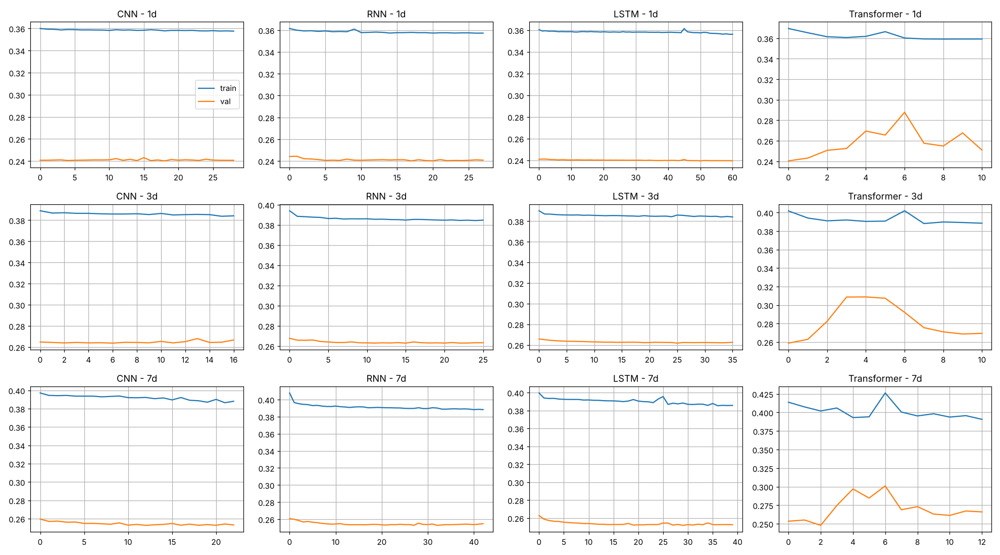

# CryptoCast: Multi-Horizon Bitcoin Price Forecasting with Deep Learning

Forecasts the Bitcoin closing price **1, 3 and 7 days ahead** from the past **60 days** of data, and compares four
deep learning architectures (**1D-CNN, RNN, LSTM, Transformer**) built in **PyTorch** against a **naive baseline**.
Results are explored in a **Streamlit** dashboard.

**Domain:** Financial Analytics / Cryptocurrency / Deep Learning

---

## Problem statement

Bitcoin prices are highly volatile and influenced by complex temporal patterns. Short-term forecasts are useful for
trading platforms, algorithmic trading, risk management and analytics dashboards. This project builds and compares
deep learning models that learn from historical price sequences to forecast Bitcoin prices over multiple horizons.

## Dataset

`Bitcoin Historical Data.csv`: daily data from **18 Jul 2010 to 24 Mar 2024** (4,999 rows).

| Column | Description |
|---|---|
| Date | Trading date (DD-MM-YYYY, newest first in the raw file) |
| Price | Closing price (target variable) |
| Open / High / Low | Opening, highest and lowest price of the day |
| Vol. | Trading volume (text with K / M / B suffixes) |
| Change % | Daily percentage change |

Modelling uses data from **1 Jan 2017** onwards (2,640 days). Earlier years are illiquid, with prices from $0.10 and
extreme percentage moves that don't represent today's market.

## Project structure

```
crypto_torch/
├── crypto_trade.py              # full pipeline: load, clean, features, split, train, evaluate, save
├── stream_torch.py              # Streamlit dashboard (reads the outputs folder)
├── Bitcoin Historical Data.csv  # dataset
├── requirements.txt
├── images/                      # result plots shown in this README
└── outputs/                     # created when you run crypto_trade.py
```

## Pipeline

| Step | What happens | Where in `crypto_trade.py` |
|---|---|---|
| 1. Load & clean | Parse DD-MM-YYYY dates, remove commas from prices, convert K/M/B volume, strip `%` | `load_data()` |
| 2. Sort by date | Oldest first, duplicates removed | `load_data()` |
| 3. Handle missing values | Full daily calendar, forward-fill gaps; zero prices treated as missing | `load_data()` |
| 4. Features | Price (mandatory) + daily log-return, high-low range, 7-day volatility, gap to 20-day average | `add_features()` |
| 5. Time-based split | 70% train / 15% validation / 15% test by date, **no shuffling** | `time_split()` |
| 6. Scaling | **MinMaxScaler fitted on training rows only**, then applied to validation and test | `Preprocessor` |
| 7. Sliding window | 60 past days in, 1 target out (one model per horizon) | `CryptoDataset` |
| 8. Train | Adam, Huber loss, dropout, early stopping on validation loss, fixed seed | `train_model()` |
| 9. Evaluate | MAE, RMSE, MAPE, R², directional accuracy, all in **USD**, vs naive baseline | `compute_metrics()` |
| 10. Save | Metrics, price comparison, next forecast, plots, trained models | `main()` |

### Avoiding data leakage

- The split is chronological: the model always trains on the past and is tested on the future.
- A sample belongs to a split only if its **target day is inside that split**, so no future prices leak backwards.
- Scalers are **fitted on training data only**.
- All `DataLoader`s use `shuffle=False`.

### Target: log-return instead of raw price

The test period reaches **$73,066**, above the training maximum of **$67,528**. A model trained on MinMax-scaled raw
prices cannot predict values outside its training range. The models therefore predict the **log-return** from today,
`log(price[t+h] / price[t])`, which is then converted back to a USD price. Set `TARGET_MODE = "price"` in
`crypto_trade.py` to compare.

## Models

| Model | Idea | Strength |
|---|---|---|
| 1D-CNN | Convolution filters slide over the 60 days | Short-term local patterns, fast |
| RNN | Hidden state carried day by day | Basic temporal learning (baseline) |
| LSTM | Input, forget and output gates control memory | Long-term dependencies, no vanishing gradient |
| Transformer | Self-attention over all 60 days + positional embedding | Global context |

**Naive baseline:** "the price in *h* days equals today's price". Every model must beat it to be useful.

## Results

Test period: **24 Feb 2023 to 23 Mar 2024** (394 forecasts per horizon).

**MAPE %** (lower is better)

| Model | 1d | 3d | 7d |
|---|---|---|---|
| Naive | 1.66 | 2.89 | 4.77 |
| CNN | 1.68 | 2.92 | 4.84 |
| RNN | 1.66 | 2.88 | 4.81 |
| LSTM | 1.66 | 2.88 | 4.80 |
| Transformer | 1.72 | 2.89 | 4.83 |

**RMSE (USD)** (lower is better)

| Model | 1d | 3d | 7d |
|---|---|---|---|
| Naive | 1,052 | 1,661 | 2,780 |
| CNN | 1,056 | 1,637 | 2,761 |
| RNN | 1,046 | 1,650 | 2,862 |
| LSTM | 1,051 | 1,653 | 2,825 |
| Transformer | 1,085 | 1,679 | 2,868 |

### Key findings

1. **Error grows with the horizon:** about 1.7% at 1 day, 2.9% at 3 days and 4.8% at 7 days.
2. **The models roughly match the naive baseline.** Daily Bitcoin prices behave close to a random walk, so the next
   price is mostly today's price plus noise. Differences between models are under 1% and change when the random
   seed changes, so no single architecture is reliably best.
3. **LSTM's long-memory advantage has little to work with** here: daily returns carry almost no long-range pattern,
   and there are fewer than 2,000 training windows.
4. **Predicting returns instead of raw prices is essential**, because test prices exceed the training range.
5. Directional accuracy is close to 50%, so these forecasts **should not be used as a stand-alone trading signal**.

### Plots

| | |
|---|---|
|  |  |
|  |  |

## How to run

```bash
pip install -r requirements.txt
python crypto_trade.py          # trains 12 models (4 models x 3 horizons), about 5-10 min on CPU
streamlit run stream_torch.py   # opens the dashboard at http://localhost:8501
```

### Outputs (`outputs/` folder)

| File | Content |
|---|---|
| `metrics_summary.csv` | MAE, RMSE, MAPE, R², directional accuracy and skill vs naive for every model and horizon |
| `price_comparison.csv` | Date, actual price, naive and all four model forecasts side by side (USD) |
| `next_forecast.csv` | Forecast from the latest 60 days |
| `forecast_grid.png`, `loss_curves.png`, `error_distribution.png`, `horizon_comparison.png` | Plots |
| `models/*.pt` | Trained PyTorch models |

## Dashboard

The Streamlit dashboard lets you select a model and horizon and shows:
metric cards compared with the naive baseline, actual vs predicted prices in USD, a price comparison table,
the error distribution, all-model comparison tables, the best model per horizon, and the next forecast.

## Business interpretation

- **Trading platforms:** use forecasts as one input signal, never alone.
- **Risk management:** the error distribution shows the typical size of price moves at each horizon.
- **Dashboards:** present forecasts with an uncertainty range rather than a single number.

## Limitations and next steps

- Price history alone ignores news, sentiment, on-chain and macroeconomic data.
- Predict ranges (quantile loss) instead of single values.
- Walk-forward validation (rolling retraining) instead of one fixed split.
- Tune window length and feature look-backs on the validation set.

## Tech stack

Python · Pandas · NumPy · PyTorch · scikit-learn · Matplotlib · Streamlit
